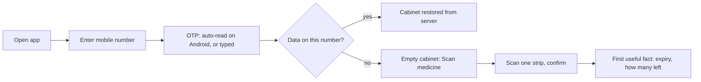
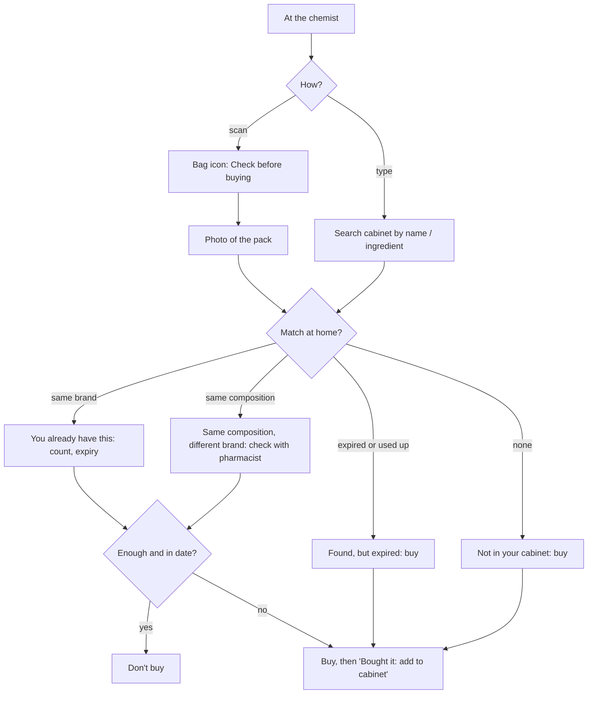
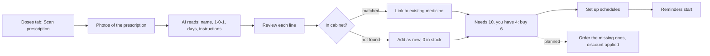
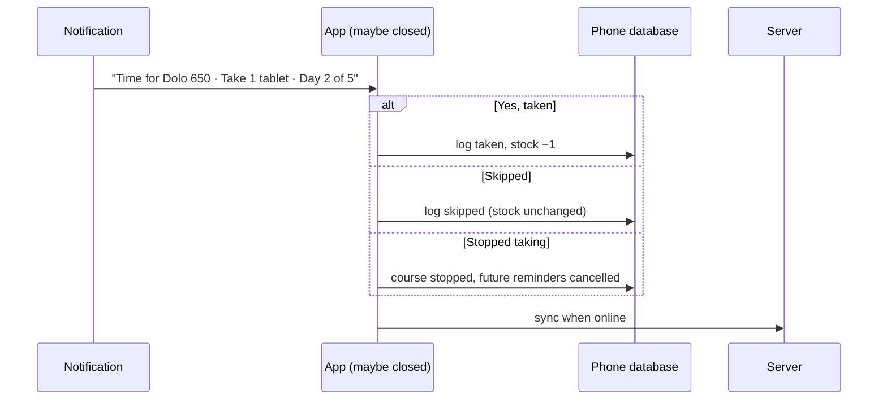
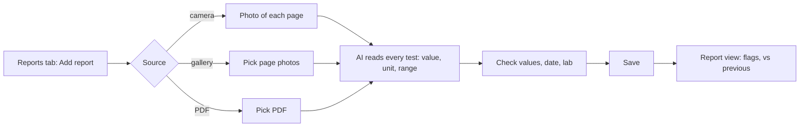
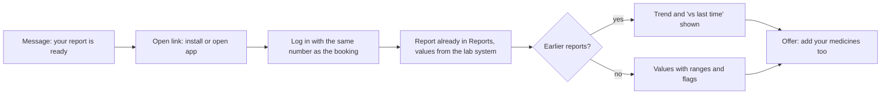
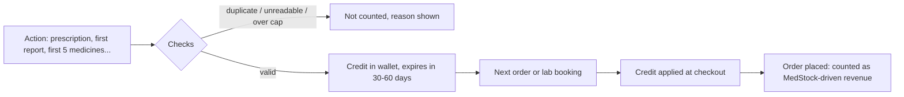

# MedStock — User Journeys

*v1 · October 2026 · Companion to the [product note](product-note.md)*

Each journey lists the **goal**, the **trigger**, the **steps in v1** (what the app does today), **friction** (where users get stuck or drop off), and the **better version** to build next. Where an incentive applies, a **Rewards (planned)** step shows how it fits, following the incentive rules in the [product note §7.2](product-note.md#72-incentives-reward-actions-that-lead-to-orders): store credit tied to the next order or booking, verified, capped and expiring. Rewards are not in v1. Diagrams render on GitHub.

| # | Journey | Who | Frequency |
|---|---|---|---|
| 1 | [First time in the app](#1-first-time-in-the-app) | New user | Once |
| 2 | [Building the cabinet (bulk onboarding)](#2-building-the-cabinet-bulk-onboarding) | New user | First week |
| 3 | [Adding a medicine after buying it](#3-adding-a-medicine-after-buying-it) | Everyone | Every purchase |
| 4 | [Do we already have this? (at the chemist)](#4-do-we-already-have-this-at-the-chemist) | Everyone | Every purchase |
| 5 | [Someone is unwell: what do we have?](#5-someone-is-unwell-what-do-we-have) | Household manager | Few times a month |
| 6 | [Setting up a course from a prescription](#6-setting-up-a-course-from-a-prescription) | Patient / caregiver | Every doctor visit |
| 7 | [Answering dose reminders](#7-answering-dose-reminders) | Patient | Daily during a course |
| 8 | [Running out: course ends or stock runs short](#8-running-out-course-ends-or-stock-runs-short) | Patient / caregiver | Monthly |
| 9 | [Expiry clean-up](#9-expiry-clean-up) | Household manager | Monthly |
| 10 | [Uploading a lab report for the first time](#10-uploading-a-lab-report-for-the-first-time) | Anyone tested | After each test |
| 11 | [Comparing reports: daily (dengue) and yearly (check-up)](#11-comparing-reports-daily-dengue-and-yearly-check-up) | Patient / caregiver | Acute episodes, yearly |
| 12 | [Fixing a wrong value](#12-fixing-a-wrong-value) | Everyone | Occasionally |
| 13 | [New phone or reinstall](#13-new-phone-or-reinstall) | Everyone | Rarely |
| 14 | [Shared phone: switching users](#14-shared-phone-switching-users) | Families | Occasionally |
| 15 | [No internet](#15-no-internet) | Everyone | Any time |
| 16 | [Caregiver managing a parent remotely](#16-caregiver-managing-a-parent-remotely-future) | Primary TG | Weekly (future) |
| 17 | [Sharing reports with a doctor](#17-sharing-reports-with-a-doctor-future) | Patient | Per consultation (future) |
| 18 | [Arriving through a lab report or an order](#18-arriving-through-a-lab-report-or-an-order-planned) | Client's customer | Once (acquisition) |
| 19 | [Referring a family member](#19-referring-a-family-member-planned) | Caregiver | Occasionally |
| 20 | [Earning and spending credit](#20-earning-and-spending-credit-planned) | Everyone | Whenever a reward is earned |

---

## 1. First time in the app

**Goal:** get in and see value within two minutes. **Trigger:** installed after a recommendation, or prompted by the pharmacy app.

**Steps in v1**
1. The login screen explains the app in one line. The user enters a 10-digit mobile number (+91 is fixed).
2. They type the OTP (6 digits auto-submit); on Android it may be read from the SMS automatically.
3. The cabinet opens. It's empty unless the number already has data on the server (journey 13).
4. The empty state points to **Scan medicine**: photo, details read, confirm, saved.

**Friction**
- An empty screen with no reward yet: the user has to do work before seeing any benefit.
- Asking for camera and notification permissions too early, or without context, leads to denials.
- If the OTP doesn't arrive, there's nothing to fall back on.

**Better version**
- Open with a single choice: "Import from your last pharmacy bill", "Scan a prescription" or "Scan one medicine", and default to the highest-value one.
- Ask for permissions at the moment they're needed (camera on first scan, notifications on first schedule). v1 already does this.
- Show a reward after the first item, e.g. "Dolo 650 expires in 4 months. Add the rest to never buy twice."

**Rewards (planned)**
- The welcome screen shows what's on offer, once: *"Add 5 medicines: ₹X off your next order"* and *"Scan a prescription: discount on the medicines you don't have"*.
- After the first item: a quiet progress line, "1 of 5 added: ₹X credit at 5". No pop-ups on later visits.
- Users who arrive through a lab report or an order (journey 18) already have data, so they see the reward that fits them instead: a re-test discount or a refill credit.

---

## 2. Building the cabinet (bulk onboarding)

**Goal:** get most of the household's medicines in without a long session. **Trigger:** first week after install. This is the hardest journey (product note §6).

**Steps in v1**
1. **Scan medicine** for each pack: details read, confirmed, saved. About 15–30 seconds per item with the AI reader.
2. **Scan prescription** adds every prescribed medicine that isn't in the cabinet yet, with count 0, and sets up its schedule.
3. **Enter manually** for anything without readable packaging.

**Friction**
- Ten medicines means ten separate scan-and-confirm loops, and attention runs out after three or four.
- Cut strips have no expiry date, so the user has to guess.
- Syrups and creams have no countable units.

**Better version**
- **Bill / invoice import:** one photo adds 5–15 items with batch and expiry already filled.
- **Drawer scan:** several strips in one photo, then one review screen.
- **Auto-add from platform orders:** no effort at all.
- **"Scan as you use":** after the first item, stop asking for more. Instead, nudge when the user opens a medicine they haven't added.
- **Progress without pressure:** "6 medicines tracked", no percentage of an unknown total.

**Rewards (planned)**
- **First 5 medicines → one-time credit** on the next order (journey 20).
- Only unique medicines count: the same brand and batch twice, or a photo that can't be read, doesn't. The confirm screen says so plainly: "Already in your cabinet: not counted."
- Each medicine needs a valid expiry date to count, which also improves data quality.
- After the first 5, adding medicines earns nothing more. The full cabinet is its own reward, and paying per item invites junk scans.

---

## 3. Adding a medicine after buying it

**Goal:** the cabinet stays current with every purchase. **Trigger:** came home from the chemist.

**Steps in v1**
1. **Scan medicine**, then **Take photo**.
2. The confirm screen shows the details read, plus "You already have this at home" if there's a match.
3. Adjust the count, then **Save to cabinet**.

**Friction**
- The user has to remember to do it; most purchases will go unrecorded.

**Better version**
- Orders from the platform are added automatically.
- After **Check before buying** (journey 4), offer **"Bought it: add to cabinet"** (built in v1).
- Bill photo import for purchases from offline chemists.

---

## 4. Do we already have this? (at the chemist)

**Goal:** avoid buying a duplicate. **Trigger:** standing at the counter, or about to check out online.

**Steps in v1:** bag icon, **Check before buying**, take a photo. The result lists matches with how many are left and the expiry date, labelled "Same medicine" or "Same composition, different brand". Nothing is saved unless the user taps **add to cabinet**.

**Friction**
- The user has to think of opening the app at the counter, which is a habit to build.
- Scanning in a shop is awkward; typing the name in search is often faster.
- A match is only as good as the cabinet's completeness (journey 2).

**Better version**
- In the pharmacy app's cart, show a "You have 8 of these at home" badge without being asked: this is the integration that makes it work.
- Recent searches and a home-screen widget for one-tap checking.

---

## 5. Someone is unwell: what do we have?

**Goal:** find a suitable medicine at home quickly and safely. **Trigger:** a child has a fever at night.

**Steps in v1**
1. Type "fever" in the cabinet search. It matches the **Commonly used for** text as well as names and ingredients.
2. Results show each medicine with its expiry badge; expired ones are clearly marked.
3. Tap one to see composition, count and expiry.

**Friction**
- **Commonly used for** is only filled in for medicines read by the AI reader, or looked up afterwards.
- No guidance on suitability: children's doses, interactions. That's deliberate; see the "don't build" list.

**Better version**
- A drug database fills in uses for every medicine.
- Results sorted in-date first, closest expiry first, with clear "Ask a doctor or pharmacist" text.
- Hide prescription-only medicines from symptom results.
- A one-tap "Talk to a doctor" handoff, if the platform offers it.

---

## 6. Setting up a course from a prescription

**Goal:** reminders for every prescribed medicine, and knowing whether there's enough. **Trigger:** back from the doctor.

**Steps in v1**
1. **Doses** tab, then **Scan prescription**. Take photos (several pages allowed), then **Read prescription**.
2. The review screen shows one card per medicine:
   - the cabinet match (or "add it")
   - dose per intake
   - times as chips (from 1-0-1, BD, TDS)
   - number of days, and instructions
   - "Needs N, you have M"
3. SOS ("as needed") lines are unticked by default.
4. **Set up schedules**. The notification permission is asked for here.

**Friction**
- Handwritten prescriptions can be misread. The review screen is essential and must be easy to correct.
- Prescription names can differ from the brand at home ("Paracetamol 650" vs "Dolo 650"); v1 matches single-ingredient medicines by ingredient and strength.
- Without the AI key, the user has to add each schedule by hand.

**Better version**
- **"Order the missing ones"** with the prescription attached: the natural cross-sell.
- Default times configurable once (the family's breakfast and dinner times).
- A drug database for brand-to-generic matching.

**Rewards (planned)**
- On the review screen, medicines that are prescribed but not at home show **"Order these 2: X% off"**. The client's cart opens pre-filled, with the prescription attached and the discount applied.
- Valid for 48 hours, because the need is immediate.
- Offered only for medicines that are on the prescription and not in stock. It never suggests extra products.
- This is the strongest reward: the reward is the order itself.

---

## 7. Answering dose reminders

**Goal:** take the dose, and keep the stock count right without effort. **Trigger:** a notification at dose time.

**Steps in v1**
1. A reminder arrives with three buttons. Pressing one works even when the app is closed; it's applied when the app next runs or resumes.
2. Tapping the notification body opens the app, where the **Doses** tab shows today's doses with ✓ / ✕ buttons.
3. Doses from the last two days that weren't answered appear under **Did you take these?**.

**Friction**
- Reminders can arrive a few minutes late (a deliberate choice, to avoid Android's exact-alarm permission).
- People ignore notifications. An unanswered dose then leaves the count uncertain.
- Elderly users may not deal well with notification buttons.

**Better version**
- WhatsApp or SMS reminders for elderly parents, with the caregiver able to see what was answered (journey 16).
- A weekly digest: "4 doses not answered this week. Tap to review."
- Snooze ("Remind me in 15 minutes").

---

## 8. Running out: course ends or stock runs short

**Goal:** never run out mid-course; refill ongoing medicines on time. **Trigger:** stock falls below what's needed.

**Steps in v1**
- The course card on the **Doses** tab warns: "Only 4 tablets left; need 6 to finish".
- The schedule screen shows "Course needs 10 tablets. You have 4. Buy 6 more."
- When a course's last day passes, it's marked completed automatically.

**Friction**
- The warning is only seen if the user opens the **Doses** tab.

**Better version**
- A push alert ("Papa's BP tablets run out in 5 days") with **Reorder**, which opens the platform's cart with the right quantity.
- Optional auto-refill subscriptions for ongoing medicines.

**Rewards (planned)**
- **Course completed with most doses answered (80%+) → credit towards a refill** of an ongoing medicine.
- The low-stock alert carries it: *"BP tablets run out in 5 days. Reorder: ₹X credit applied."*
- No credit for short courses that simply end (an antibiotic finished). Nothing needs reordering there, and a reward would only push an unneeded purchase.

---

## 9. Expiry clean-up

**Goal:** stop using expired medicines; use soon-to-expire ones first. **Trigger:** a monthly habit, or noticing the "Expired" count.

**Steps in v1**
1. The cabinet's **Expired (n)** and **Expiring (n)** filters list them; badges show "Expired" in red and "Exp Mar 2027" in amber within 60 days.
2. Open a medicine, then delete it, or adjust the count if some were used.

**Friction**
- Nothing prompts the user, so they have to remember.
- No guidance on how to dispose of expired medicines.

**Better version**
- A monthly notification: "2 expired, 3 expire this month", leading to a review list with bulk **Remove**.
- Disposal guidance and drop-off points.
- **Replace** for expired medicines the household uses regularly.

**Rewards (planned)**
- Removing expired medicines that the household uses again and again (bought before, or on an ongoing course) offers **"Replace 2 expired: Y% off"**.
- No replacement offer for one-off medicines nobody needs again.
- To prevent gaming, a medicine counts only if it was in the cabinet for 30+ days before it expired. Adding already-expired items earns nothing.
- Once per medicine.

---

## 10. Uploading a lab report for the first time

**Goal:** get a report in, with its values readable and comparable. **Trigger:** report received on WhatsApp or email, or as a printout.

**Steps in v1**
1. **Reports** tab, then **Add report**. Choose **Take a photo**, **Choose photos (one per page)** or **Upload PDF**.
2. A dialog reads the report (up to a minute for long check-ups).
3. The review screen lists every test: name, result, unit, low and high. The report name, lab and sample date are editable.
4. **Save**. The report view groups values by section, flags low/high values and shows "↓ from … on …" against the previous report.

**Friction**
- Getting the file into the app: reports usually arrive on WhatsApp, so the user has to save it first, then pick it.
- Long check-up reports (60+ tests) take a while to review.
- Without the AI key, values have to be typed in by hand.

**Better version**
- **Share to MedStock** from WhatsApp, email or the files app (Android share target / iOS share extension).
- Reports from the platform's own lab arrive automatically with no reading step; ABHA/ABDM-linked labs too.
- Review only the flagged and low-confidence values, and accept the rest in bulk.

**Rewards (planned)**
- After the **first** report is saved: *"Your next test with [client]: Z% off"*, valid for 60 days (journey 20).
- To count, the report must read as a real lab report, with a sample date and at least 3 results. Only the first report is rewarded; later uploads aren't.
- Reports delivered automatically from the client's own lab earn no upload reward, since there's no effort to reward. They get re-test reminders instead (journey 11).

---

## 11. Comparing reports: daily (dengue) and yearly (check-up)

**Goal:** see the direction of change at a glance. **Trigger:** a new report arrives, or a doctor asks "how were the platelets yesterday?".

**Steps in v1**
1. In any report, tap a test (e.g. Platelet count). The trend opens:
   - a chart over time, with the normal range shaded green
   - every value listed, newest first
2. Or go to **Reports**, then **Trends**: every test ever recorded, the most-tracked first, with its latest value.
3. Test names are standardised ("Platelet count") and lakh / ×10³ counts converted, so different labs line up.
4. If units differ between reports, a note warns that the values may not be directly comparable.

**Dengue example:** six daily CBCs from two labs. The platelet trend shows 1.2L → 85k → 62k → 58k → 91k → 1.4L against the 1.5L–4.1L band, and the doctor sees the recovery turn instantly.

**Friction**
- Each daily report still has to be added by hand during a stressful week.
- Tests named very differently by labs may not merge.

**Better version**
- Home-collection booking with results flowing straight into the trend.
- A pinned "watch" test during an acute episode (platelets, haematocrit) on the home screen.
- A year-on-year comparison table for annual check-ups (this year vs last year vs two years ago, with change).

**Rewards (planned)**
- **During an acute episode (dengue):** after a daily report is added, *"Book tomorrow's home collection"*, using the first-report discount if it hasn't been spent.
- **Annual check-up:** 11 months after the last one, *"Book this year's check-up and compare with last year"*, with a re-test discount.
- Viewing reports and trends earns nothing. Rewards follow actions that lead to a booking.

---

## 12. Fixing a wrong value

**Goal:** correct a misread expiry, count or lab value. **Trigger:** noticing something wrong.

**Steps in v1**
- **Medicine:** tap it, edit any field, **Save changes**. If a dose was answered while the screen was open, the stored count is kept unless the user changed it there.
- **Report:** open it, **Edit**, change values, **Save report**.
- **Schedule:** open the course card to change times or days, or stop it.

**Better version:** highlight fields the AI wasn't sure about at scan time, so errors are caught before saving.

---

## 13. New phone or reinstall

**Goal:** everything comes back. **Trigger:** new phone, reinstall, cleared app data.

**Steps in v1**
1. Install, then log in with the same mobile number and OTP.
2. Sync pulls the medicines, schedules, dose history and lab values. Reminders are rescheduled.

**Friction**
- Label photos and report files are not backed up yet, so only the extracted data returns.

**Better version:** back up files to the server (encrypted object storage).

---

## 14. Shared phone: switching users

**Goal:** two family members use one phone without mixing data. **Trigger:** a parent uses the child's phone.

**Steps in v1**
1. Account icon on the cabinet screen, then **Sign out**. This syncs first, then stops this user's reminders.
2. The other person logs in with their own number and gets their own separate data on the phone and the server.

**Friction:** switching back and forth is clumsy, and reminders only fire for the signed-in user.

**Better version:** family profiles in one household (journey 16) instead of separate logins.

---

## 15. No internet

**Goal:** the app works anywhere. **Trigger:** a hospital basement, travel, a patchy connection.

**Steps in v1**
- Everything except AI reading works offline: the cabinet, search, doses, reminders and reports already saved.
- The account icon shows a badge when offline, and the sheet says "changes are saved on this phone and will sync later". Sync catches up automatically when the connection returns.
- The AI reader falls back to on-device OCR for packs. Prescriptions and reports wait until the user is online.

---

## 16. Caregiver managing a parent remotely (future)

**Goal:** a daughter in Bengaluru keeps track of her parents' medicines in Ahmedabad. **Trigger:** weekly check-in, or a parent's call.

**Planned journey**
1. The caregiver creates a household and invites "Papa" and "Mummy" by phone number. They accept with OTP, or the caregiver manages their profiles.
2. Each profile has its own cabinet and courses. The caregiver sees everything; the parents see a simple, large-text view.
3. Dose reminders reach the parents (app or WhatsApp). The caregiver sees "Papa: 12 of 14 doses taken this week".
4. "BP tablets run out in 5 days" reaches the caregiver, who reorders for delivery to the parents' address.

**Why it matters:** this is the primary TG's real situation, and it's where repeat orders come from.

---

## 17. Sharing reports with a doctor (future)

**Goal:** the doctor sees the trend without a phone being handed over. **Trigger:** a consultation, in person or online.

**Planned journey**
1. Open a trend or report, then **Share with doctor**.
2. Choose what to include (this report, the platelet trend, the last three CBCs) and for how long (24 hours).
3. A link or QR code opens a read-only web page. Access is logged and expires.

---

## 18. Arriving through a lab report or an order (planned)

**Goal:** start with a useful record on day one, with no effort and no incentive needed. **Trigger:** an SMS or WhatsApp from the client: "Your report is ready" or "Your order is delivered".

**Planned steps**
1. The message links to MedStock. Install, then log in with OTP on the same number used for the booking or order.
2. **Lab report:** it's already in **Reports**, read from the lab's structured data, so no AI and no checking are needed. Earlier reports from the same lab show as a trend.
3. **Order:** "Track these medicines?" One tap adds every item with batch and expiry. If a prescription was attached, reminders are offered.
4. Only then does the app suggest the next step: "Add the medicines you already have", with the first-5 reward from journey 2.

**Why it matters:** the user is activated at zero cost, and the record starts complete. It's the cheapest acquisition channel (product note §7.1).

---

## 19. Referring a family member (planned)

**Goal:** bring parents or siblings in. **Trigger:** a caregiver wants a parent's medicines tracked too.

**Planned steps**
1. **Account → Invite family**, then share a link over WhatsApp.
2. The family member installs and logs in with OTP on their own number.
3. **Credit for both only after the new user's first order** (journey 20). Installing alone earns nothing.

**Rules**
- The new number must be new to the client: no rewards for inviting existing customers.
- A cap per referrer (e.g. 5 rewarded referrals).

---

## 20. Earning and spending credit (planned)

**Goal:** rewards that are easy to understand and bring an order back to the client. **Trigger:** any reward from journeys 1, 2, 6, 8, 9, 10, 11 or 19.

**Planned steps**
1. When an action qualifies, a short confirmation: "₹X credit added, use it by 20 Nov."
2. **Account → Rewards** shows the balance, the expiry dates and how each credit was earned.
3. At checkout in the client's app or booking flow, credit is applied automatically, above a minimum order value.
4. A reminder 5 days before credit expires. No further nagging.

**When something doesn't count**, say why in one line ("Already in your cabinet", "Couldn't read a sample date on this report"). Never fail silently.

**For the business:** every credit is tagged with the action that earned it. Orders that spend it count as MedStock-driven revenue, and each reward type is checked against a holdout group (product note §7.4).

---

## Cross-journey principles

- **One tap to finish:** every notification leads to an action completed in one tap.
- **Confirm what the AI read:** scans and readings are always reviewed before saving; highlight what's uncertain.
- **Never diagnose or prescribe:** show what's at home and what the values are; send judgement to a doctor or pharmacist.
- **Approximate beats empty:** a rough count today beats a perfect list never.
- **Works offline, syncs later:** the phone is the source of truth for the moment; the server is the backup and the bridge between devices.
- **Rewards follow real actions and pay out on orders:** store credit for the next order or booking, verified, capped and expiring. Never cash, never per item added, and never a condition for using the app.
- **Never reward "don't buy":** telling a user they already have a medicine is a trust moment, not a transaction.
